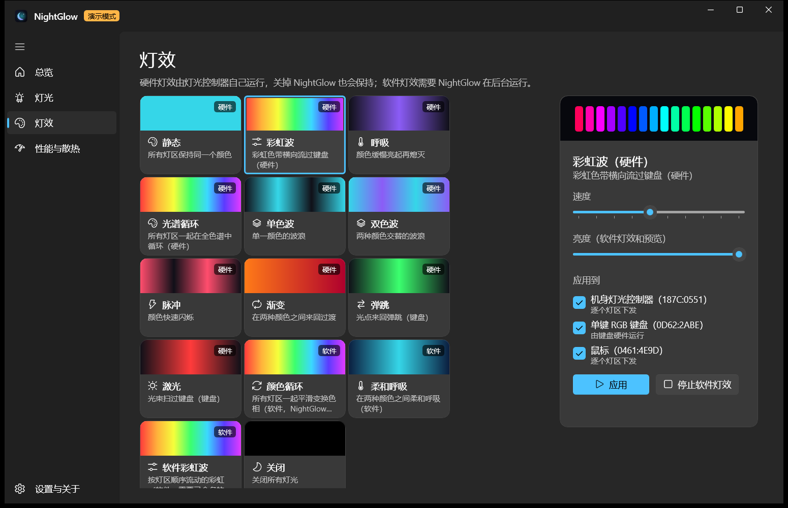
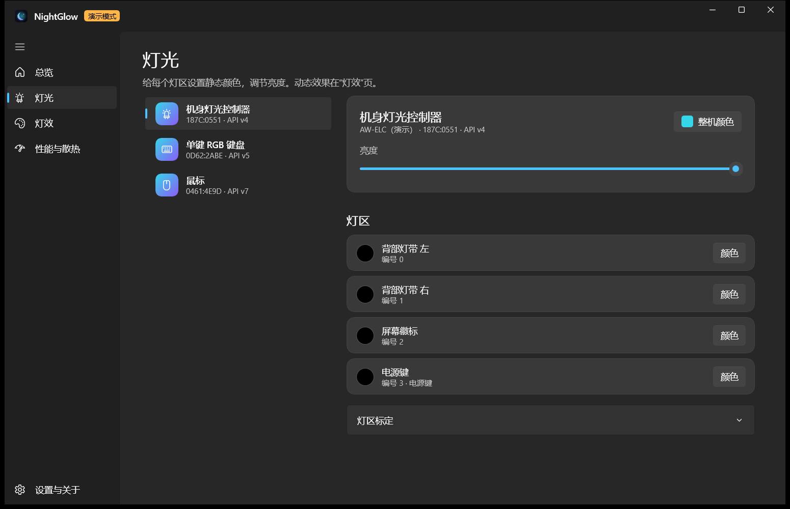
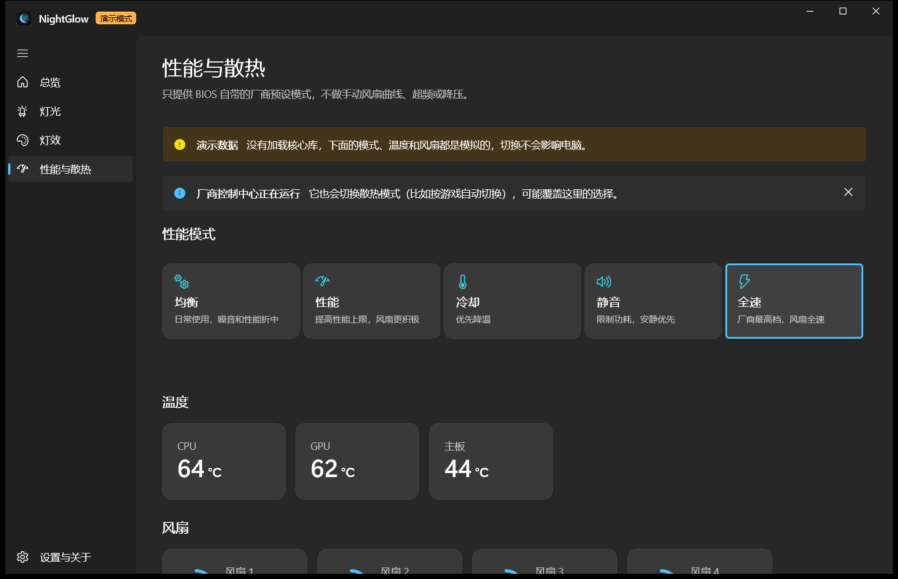

# NightGlow

适用于 Alienware 笔记本的灯光、风扇和电源控制工具，界面用 WinUI 3 重写，底层复用 [alien-tools](https://github.com/T-Troll/alien-tools) 的硬件控制代码。

> **声明**
> - NightGlow 是社区项目，**与 Dell / Alienware 没有任何关系**，也没有得到它们的认可或支持。"Alienware" 只用来说明适用的电脑。
> - 本软件会**直接控制灯光、风扇和电源模式**，**使用风险自负**。作者不对任何硬件损坏、数据丢失或保修问题负责。
> - 只提供 BIOS 自带的厂商预设模式；不做手动风扇曲线、超频、降压，也不改 BIOS。



| 灯光 | 性能与散热 |
|---|---|
|  |  |

（截图是演示模式：没有加载核心库，数值是模拟的。）

## 现状（0.1 预览版）

| 功能 | 状态 |
|---|---|
| 识别灯光设备（HID：机身灯 API v4、单键 RGB 键盘 API v5、鼠标 API v7 等） | 代码完成，**待硬件实测** |
| 每个灯区设静态颜色、整机颜色、亮度 | 代码完成，待实测 |
| 按区域选择：键盘 / 背部灯环 / Logo / 其他灯光，在笔记本示意图上点选，一个灯效可以同时铺满多个区域、节奏一致 | 完成（演示模式可预览），待实测 |
| 改动立即生效，不用再点“应用” | 完成 |
| 硬件灯效：静态、默认蓝、彩虹波、呼吸、光谱循环、单色波、双色波、脉冲、渐变、弹跳、激光；可调速度、时长（机身灯）、亮度。硬件彩虹波在灯环上按方向错开相位，关掉 NightGlow 也会流动 | 代码完成，待实测（速度方向需要实测确认） |
| 软件灯效：彩虹波（8 个方向：左右、前后、中心扩散 / 汇聚、顺 / 逆时针；7 种配色，含自定义双色），键盘和灯环同一节奏 | 完成（演示模式可预览） |
| 互动灯效：水滴涟漪，在示意图上点哪里就从哪里荡开波纹，可自动下雨 | 完成（演示模式可预览） |
| 软件灯效：颜色循环、柔和呼吸 | 完成 |
| 照明模式：正常 / 调暗 / 关闭（不改当前灯效） | 代码完成，待实测 |
| 与厂商控制中心的灯效对照 | 见 [docs/effects-parity.md](docs/effects-parity.md) |
| 灯光识别向导：逐个点亮，点“背部灯环 / Logo / 其他 / 没亮”即可；灯环可测试流动、反转方向、移动起点 | 代码完成，待实测 |
| 键位标定：逐个点亮键盘灯，按下亮着的键，之后灯效可以逐键流动 | 代码完成，待实测 |
| 手动标定：输入编号点亮并命名（与 alien-tools 共用同一份名称） | 代码完成，待实测 |
| 切换性能模式（只用 BIOS 报告的厂商预设） | 代码完成，待实测，需要管理员 |
| 显示温度和风扇转速 | 代码完成，待实测，需要管理员 |
| 检测厂商控制中心是否在运行并提示 | 完成（不会停止它） |
| 没有核心库时的演示模式 | 完成 |

## 运行要求

- Windows 10 2004（19041）或更新，x64。
- 灯光：普通用户权限即可。
- 风扇、温度、性能模式：需要以管理员身份运行（BIOS 的 WMI 接口只允许管理员调用）。程序里有"以管理员身份重启"按钮。
- 和厂商控制中心同时运行时，两边会互相覆盖灯光和散热设置。NightGlow 只提示，不会去停止厂商软件。

## 目录结构

```
NightGlow/
  native/NightGlowCore/   C 接口 DLL（nightglow_core.dll），包一层 alien-tools 的 SDK
    nightglow_core.h      对外接口（纯 C 类型，可以从任何语言调用）
    ng_lights.cpp         灯光：AlienRGB_SDK
    ng_thermal.cpp        风扇/温度/电源：alienfan-SDK_v2
  src/NightGlow/          WinUI 3 界面（C#，.NET 10）
    Core/Interop          P/Invoke 声明
    Core/Lighting         灯光服务、灯效库、软件灯效引擎、演示后端
    Core/Thermal          风扇/温度/电源服务（专用 MTA 线程）
    Pages/                总览、灯光、灯效、性能与散热、设置与关于
  tools/                  图标生成、窗口截图脚本
```

上游的 SDK 源码**原地编译**，没有复制进来，以后合并上游更新时不用手动同步。

### 为什么是"C# 界面 + C 接口 DLL"

- 上游 SDK 是普通 C++（STL + Win32 HID + WMI），包 30 来个 `extern "C"` 函数就能用，上游代码基本不用改。
- C# 写 WinUI 3 的效率远高于 C++/WinRT（数据绑定、MVVM 工具包、代码量少），编译也快。
- C 接口让以后把风扇/电源拆成单独的管理员助手进程很容易，界面本身可以一直用普通权限运行。

## 编译

需要：

1. **Visual Studio 2026 Build Tools**（C++ 桌面开发 + Windows 11 SDK），用来编译 `nightglow_core.dll`（上游用 v145 工具集）：
   ```powershell
   winget install --id Microsoft.VisualStudio.BuildTools --override "--quiet --wait --add Microsoft.VisualStudio.Workload.VCTools --includeRecommended"
   ```
2. **.NET 10 SDK**，用来编译界面。

然后在仓库根目录运行：

```powershell
powershell -ExecutionPolicy Bypass -File NightGlow\build.ps1
```

脚本会先编译 `nightglow_core.dll`（找不到 MSBuild 就跳过，界面以演示模式运行），再发布界面到 `NightGlow\publish\`。

只编译界面（演示模式）：

```powershell
dotnet build NightGlow\src\NightGlow\NightGlow.csproj -c Debug -p:Platform=x64
```

命令行参数 `--page=home|lighting|effects|performance|settings` 可以直接打开某一页。

## 许可证

MIT，见 [LICENSE](LICENSE)。硬件控制代码来自 alien-tools（MIT，Copyright (c) 2020 Rik Lain）。第三方组件见 [THIRD_PARTY_NOTICES.md](THIRD_PARTY_NOTICES.md)。
