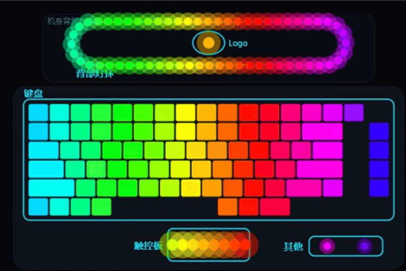
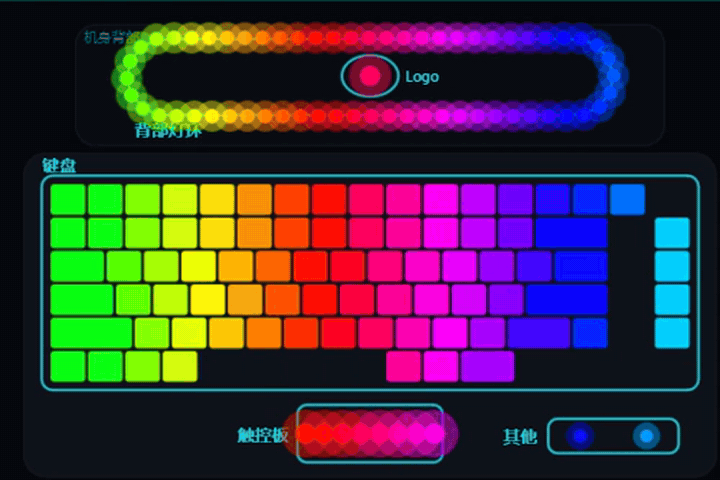
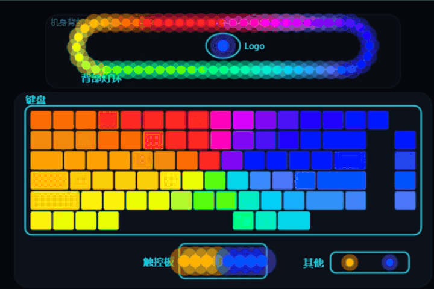
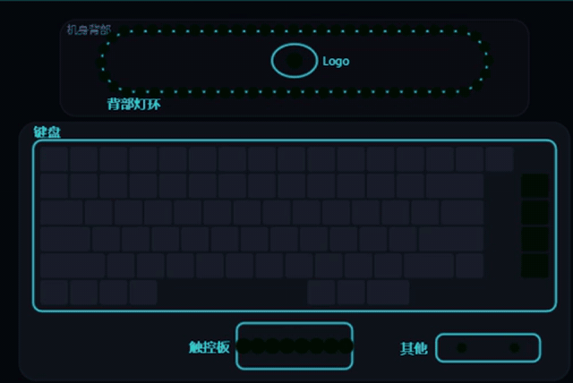
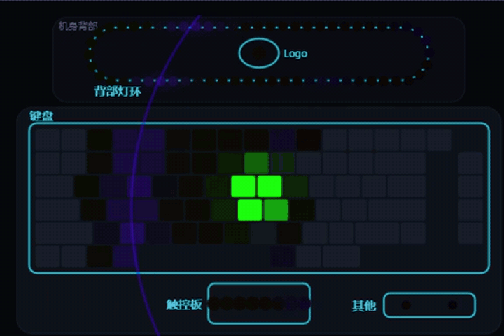
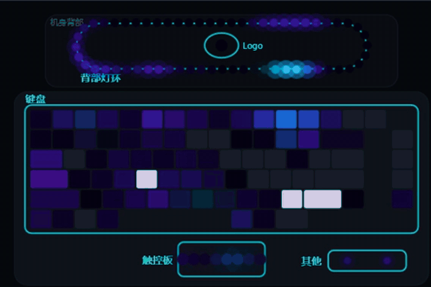
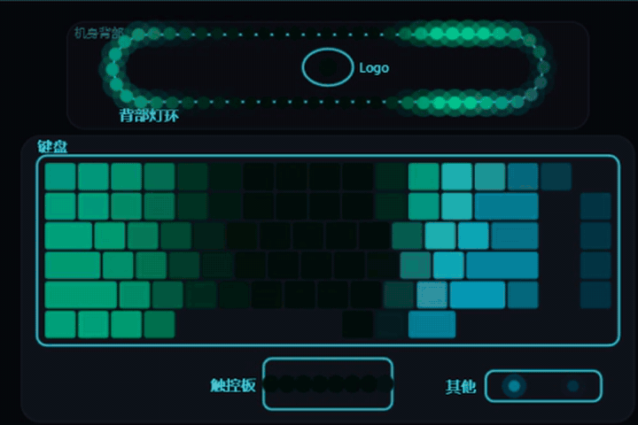
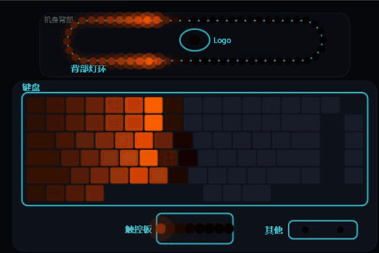
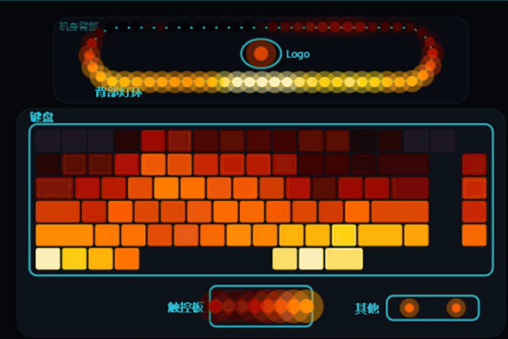
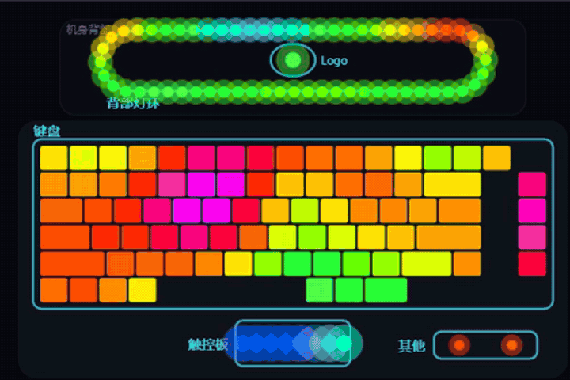

# 🌙 NightGlow

<b>Open-source lighting for Alienware laptops. Every zone, every key, one rhythm.</b> 
<b>给 Alienware 笔记本的开源灯光软件。每个区域、每个键，同一个节奏。</b>

<a href="#download">🚀 Download</a> · <a href="#effects">🎨 Effects</a> · <a href="#features">✨ Features</a> · <a href="#safety">🛡️ Safety</a> · <a href="#credits">🙏 Credits</a> · <a href="#zh">📖 中文</a>

**▶ [Watch the 56-second demo · 观看 56 秒演示视频](docs/media/NightGlow-showcase.mp4)**

> **Unofficial.** NightGlow is a community project. It is not made, endorsed or supported by Dell or Alienware. Tested only on an **Alienware x16 R2**. Use at your own risk.
>
> **非官方。** NightGlow 是社区项目，不是戴尔或 Alienware 出品，也没有得到它们的认可或支持。目前只在 **Alienware x16 R2** 上实测过，使用风险自负。

## 🌍 English

NightGlow is a lighting app for Alienware laptops, built on the open-source [alien-tools](https://github.com/T-Troll/alien-tools) SDK (formerly alienfx-tools). It drives the keyboard, the rear light ring, the alien-head logo and the touchpad as one canvas, so a wave that starts on the keys keeps going around the ring at the same speed. It is free, open source, and will never be sold.

### 🎨 Effects

Every effect below is recorded from the app's live preview. On the laptop the same frames play on the real lights at about 40 fps, key by key.

<table>
<tr>
<td width="50%" valign="top"> <b>🌈 Rainbow wave</b> One clock, one coordinate space: keys, ring, logo and touchpad flow together. Eight directions.</td>
<td width="50%" valign="top"> <b>🔄 Orbit</b> Colour circles the whole machine, clockwise or counter-clockwise.</td>
</tr>
<tr>
<td width="50%" valign="top"> <b>🎨 From the centre</b> Spread out from the middle or gather in. Seven palettes, plus your own two colours.</td>
<td width="50%" valign="top"> <b>💧 Ripples</b> Click anywhere on the preview and a ripple spreads from that spot. Or let it rain.</td>
</tr>
<tr>
<td width="50%" valign="top"> <b>🌌 Nebula</b> Slow drifting clouds of colour.</td>
<td width="50%" valign="top"> <b>🌠 Aurora</b> Soft green and violet curtains.</td>
</tr>
<tr>
<td width="50%" valign="top"> <b>⚡ Laser scan</b> A bright line sweeps across, leaving a fading trail.</td>
<td width="50%" valign="top"> <b>🔥 Fire</b> Flames rise from the bottom row.</td>
</tr>
<tr>
<td width="50%" valign="top"> <b>🔮 Plasma</b> Liquid colour that never repeats.</td>
<td width="50%" valign="top"> <b>⌨️ Per key, 40 fps</b> Each key is its own light. Shown here in the sakura palette.</td>
</tr>
</table>

Also included: ✨ starfield, and the keyboard's built-in effects (static, breathing, single and dual colour wave, pulse, morph, bounce, spectrum, rainbow wave), which keep running after NightGlow closes.

### ✨ Features

- 🗺️ **Pick zones on a picture.** Click the laptop diagram to choose the keyboard, rear ring, logo or touchpad. Changes apply at once.
- 🧭 **Light-finding wizard.** Lights up one LED at a time; click where you saw it on the laptop picture, or press Space if nothing lit. On the x16 R2 every light is already mapped.
- ⌨️ **Key calibration.** For other per-key keyboards: press the key that is lit, and the keyboard learns its own layout. Keys are read only while the calibration box has focus.
- ▶️ **One-click showcase.** Plays every software effect in turn, the way the demo video was made.
- ⚡ **Performance presets.** Switch between the vendor presets your BIOS reports (Balanced, Performance, Cool, Quiet, Full Speed). Needs administrator rights. *Not yet verified on hardware in this preview.*
- 🌙 **Dark, clean interface.** Five pages: Overview, Lights, Effects, Performance & cooling, Settings.

### 🚀 Download and run

1. Download `NightGlow-v0.1.0-preview.zip` from [Releases](../../releases) and check its SHA256 against the release notes.
2. Extract it to a short path, such as `C:\NightGlow`.
3. Run `NightGlow.exe`. Lighting works without administrator rights. Performance presets ask for them.

AWCC can keep running alongside NightGlow, but it may overwrite your lights. NightGlow only warns you; it never closes or uninstalls AWCC.

Build from source: run `build.ps1` in this folder (needs Visual Studio Build Tools with the C++ workload and the .NET 10 SDK).

### 🛡️ Safety

- Only the vendor's own presets. **No manual fan curves, no overclocking, no voltage changes.**
- One LED next to the power button is excluded, because writing to it makes the power button flash.
- No telemetry, no account, no network access. (The About page has one link to the upstream project; it opens in your browser only if you click it.)

### 🧪 Tested

| | Status |
|---|---|
| Alienware x16 R2: per-key keyboard (0D62:2ABE), lights controller (187C:0551: rear ring, logo, touchpad) | ✅ Verified on real lights |
| Alienware 610M mouse | 🔍 Detected; lighting not yet verified |
| Performance presets (WMI) | ⏳ Not yet verified |
| Other Alienware models | ❔ Untested; reports welcome |

### 🙏 Credits

- [T-Troll/alien-tools](https://github.com/T-Troll/alien-tools) (MIT): the lighting and fan SDKs NightGlow is built on.
- Low-level lighting code in that SDK originates from [Gurjot95/AlienFX-SDK](https://github.com/Gurjot95/AlienFX-SDK). See [THIRD_PARTY_NOTICES](THIRD_PARTY_NOTICES.md).

License: [MIT](LICENSE). Alienware and Dell are trademarks of Dell Inc.; NightGlow is not affiliated with them.

---

## 🀄 中文

<a href="#en">⬆ English</a>

NightGlow 是给 Alienware 笔记本用的灯光软件，基于开源的 [alien-tools](https://github.com/T-Troll/alien-tools) SDK（原名 alienfx-tools）做成。它把键盘、背部灯环、外星人头 Logo 和触控板当成一整块画布来驱动：一道波从键盘出发，会用同样的速度接着绕过灯环。免费、开源，永不商业化。

### 🎨 灯效

下面每一段都录自软件里的实时预览。在笔记本上，同样的画面会逐键、以大约每秒 40 帧的速度播放到真实的灯上。

<table>
<tr>
<td width="50%" valign="top"> <b>🌈 彩虹波</b> 同一个时钟、同一套坐标：键盘、灯环、Logo、触控板一起流动。8 个方向可选。</td>
<td width="50%" valign="top"> <b>🔄 环绕</b> 颜色绕着整台机器转，顺时针或逆时针。</td>
</tr>
<tr>
<td width="50%" valign="top"> <b>🎨 中心扩散</b> 从中间向外散开，或者向内收拢。7 种配色，也能自定两种颜色。</td>
<td width="50%" valign="top"> <b>💧 水滴涟漪</b> 在预览图上点哪里，波纹就从哪里荡开。也可以打开自动下雨。</td>
</tr>
<tr>
<td width="50%" valign="top"> <b>🌌 星云</b> 缓慢飘动的彩色云团。</td>
<td width="50%" valign="top"> <b>🌠 极光</b> 柔和的绿紫色光幕。</td>
</tr>
<tr>
<td width="50%" valign="top"> <b>⚡ 激光扫描</b> 一道亮线扫过，身后留下渐隐的尾迹。</td>
<td width="50%" valign="top"> <b>🔥 火焰</b> 火苗从最下面一排往上蹿。</td>
</tr>
<tr>
<td width="50%" valign="top"> <b>🔮 等离子</b> 像液体一样流动、不会重复的颜色。</td>
<td width="50%" valign="top"> <b>⌨️ 逐键 40 帧</b> 每个键都是一盏独立的灯。图中是樱花配色。</td>
</tr>
</table>

另外还有 ✨ 星空，以及键盘固件自带的效果（静态、呼吸、单色波、双色波、脉冲、渐变、弹跳、光谱、彩虹波）。固件效果在关掉 NightGlow 之后也会继续。

### ✨ 功能

- 🗺️ **在图上选区域。** 点笔记本示意图，选键盘、背部灯环、Logo 或触控板，改了立刻生效。
- 🧭 **灯光识别向导。** 一次点亮一颗灯，你在笔记本示意图上点它亮的位置，没亮就按空格。x16 R2 的每颗灯都已经标好，不用再做。
- ⌨️ **键位标定。** 给其他单键 RGB 键盘用：按下亮着的那个键，键盘就学会自己的布局。只在标定框有焦点时读取按键。
- ▶️ **一键演示。** 依次播放所有软件灯效，演示视频就是这样录的。
- ⚡ **性能预设。** 在 BIOS 提供的厂商预设之间切换（平衡、性能、凉爽、安静、全速），需要管理员权限。*这个预览版还没在真机上验证。*
- 🌙 **简洁的深色界面。** 五个页面：总览、灯光、灯效、性能与散热、设置。

### 🚀 下载和运行

1. 从 [Releases](../../releases) 下载 `NightGlow-v0.1.0-preview.zip`，并对照发布说明核对 SHA256。
2. 解压到短路径，比如 `C:\NightGlow`。
3. 运行 `NightGlow.exe`。灯光功能不需要管理员权限；切换性能预设时会请求。

AWCC 可以和 NightGlow 同时运行，但它可能把你的灯光改回去。NightGlow 只会提示，不会关闭或卸载 AWCC。

从源码编译：在本目录运行 `build.ps1`（需要带 C++ 工作负载的 Visual Studio Build Tools 和 .NET 10 SDK）。

### 🛡️ 安全

- 只用厂商自己的预设。**不提供手动风扇曲线、不超频、不改电压。**
- 电源键旁边的一颗灯被排除了，因为写它会让电源键闪烁。
- 不收集数据，不需要账号，不联网。（"设置与关于"页有一个上游项目的链接，只有你点它时才会在浏览器里打开。）

### 🧪 测试情况

| | 状态 |
|---|---|
| Alienware x16 R2：单键 RGB 键盘（0D62:2ABE）、灯光控制器（187C:0551：背部灯环、Logo、触控板） | ✅ 已在真灯上验证 |
| Alienware 610M 鼠标 | 🔍 能识别，灯光尚未验证 |
| 性能预设（WMI） | ⏳ 尚未验证 |
| 其他 Alienware 型号 | ❔ 未测试，欢迎反馈 |

### 🙏 致谢

- [T-Troll/alien-tools](https://github.com/T-Troll/alien-tools)（MIT）：NightGlow 所基于的灯光和风扇 SDK。
- 该 SDK 中的底层灯光代码源自 [Gurjot95/AlienFX-SDK](https://github.com/Gurjot95/AlienFX-SDK)，详见 [THIRD_PARTY_NOTICES](THIRD_PARTY_NOTICES.md)。

许可证：[MIT](LICENSE)。Alienware 和 Dell 是 Dell Inc. 的商标，NightGlow 与其无关。
